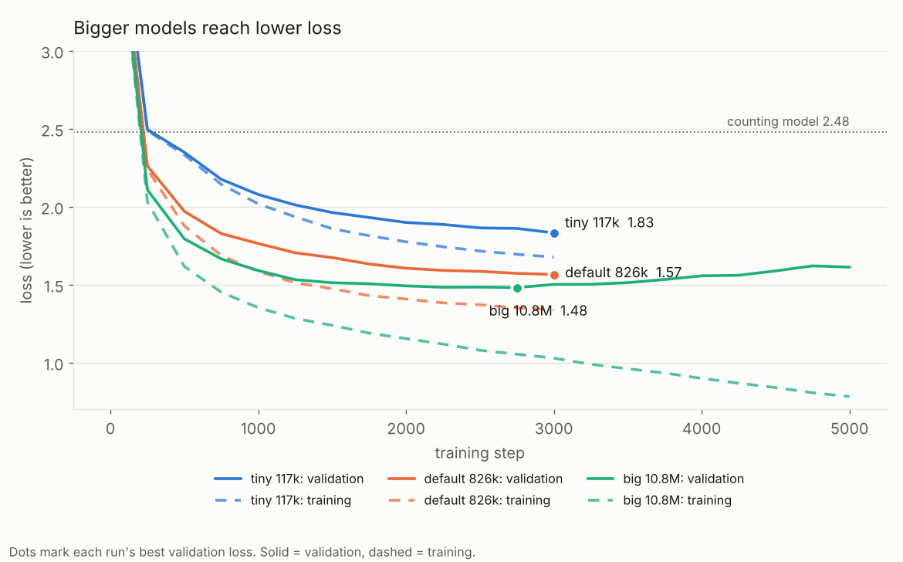
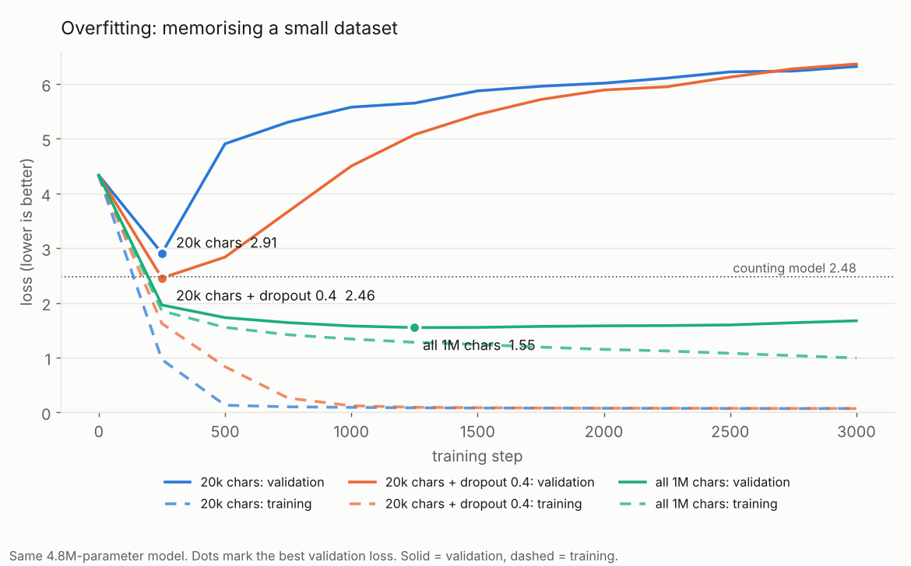
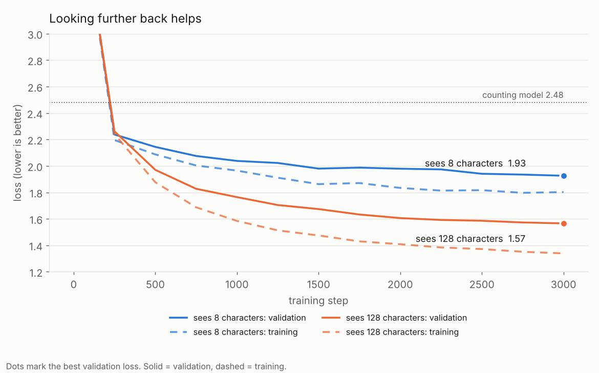

# Tiny GPT from Scratch

A small GPT-style language model, the same design as Llama, Qwen and ChatGPT but tiny, built from scratch in PyTorch and trained on the complete plays of Shakespeare until it writes fake Shakespeare. It's followed by experiments on model size, overfitting and how far back the model can see.

**Main result:** the best model reached a validation loss of **1.48**, compared with **2.48** for a simple counting model and 4.17 for random guessing.

## What's in here

| File / folder | What it is |
|---|---|
| `tiny_gpt_colab.ipynb` | The whole project as a notebook, with explanations and all outputs. Opens in Google Colab (free GPU). |
| `results/` | Loss logs (`log.csv`) and writing samples (`samples.txt`) for every training run, plus `summary.json` |
| `charts/` | Loss curve charts used below |
| `run-locally/` | The same project as Python scripts, for running on your own NVIDIA GPU |

## How it was built

The project builds up in four steps:

1. **Counting model:** predicts the next character from how often each character follows each other one in the training text. Loss **2.48**.
2. **Bigram neural network:** the same model learned by gradient descent instead of counting. Training rediscovered the counts and reached about the same loss, about 2.5.
3. **Tiny GPT:** adds token and position embeddings, causal self-attention (multiple heads), MLP blocks and residual connections, so the model can use the previous 128 characters instead of just one.
4. **Experiments:** seven training runs varying size, training data, dropout and context length.

The text is "Tiny Shakespeare": about 1.1 million characters, tokenised one character per token (65 distinct characters). 90% was used for training and 10% held back for validation. All runs used a free Google Colab T4 GPU.

## Results

| Run | Parameters | Best validation loss | What changed |
|---|---|---|---|
| Counting model | 4,225 | 2.48 | Baseline: looks at one character |
| `tiny` | 117k | 1.83 | 2 layers, 64-wide |
| `context8` | 811k | 1.93 | Default model, but sees only 8 characters back |
| `default` | 826k | 1.57 | 4 layers, 4 heads, 128-wide, sees 128 characters |
| `big` | 10.8M | **1.48** | 6 layers, 6 heads, 384-wide, sees 256 characters, 5,000 steps |
| `overfit` | 4.8M | 2.91 | Trained on only 20,000 characters, no dropout |
| `overfit_dropout` | 4.8M | 2.46 | Same, with dropout 0.4 |
| `overfit_moredata` | 4.8M | 1.55 | Same model, all the training data, no dropout |

Lower is better. Loss is cross-entropy on the validation text the model never trained on.

## Findings

### 1. Attention is what makes the difference
The default GPT's loss of 1.57 is far below the counting model's 2.48. Its writing goes from random characters to recognisable play structure (speaker names, line breaks, real words) within about 1,000 training steps:

> **Step 0** (loss 4.32): `WFwHcHPgRWkWfDEdnYJmzqImW: Yo3&$FMtofVidIvB!!&V!OW;Kd!...`
>
> **Step 250** (loss 2.26): `BUCENCE: Abut: Iatime pagh, unte, thom ar, my louingstim'`
>
> **Step 1000** (loss 1.76): `IVENCENTIO: Marcier art of your advice? / To ktild, all of Marcius...`

### 2. Bigger models are better, with diminishing returns


- Going from 117k to 826k parameters (7×) improved the loss by **0.27**.
- Going from 826k to 10.8M (13×) improved it by only **0.08**.
- The big model writes the most convincing text: *"Great perform'd to my tongue with them and i' / Ten and order to reply mine own success, / And old several heart doth kill it honesty."*
- **Even the big model began to overfit:** its best validation loss came at step 2,750. After that, training loss kept falling (1.05 → 0.78) while validation loss rose (1.48 → 1.61). Saving the best version during training, rather than the last, avoided that.

### 3. Overfitting: more data beat dropout by a wide margin


- **With only 20,000 characters, the model memorised them.** Training loss fell to 0.07 while validation loss rose from 2.91 to **6.32**, worse than random guessing (4.17). Its best validation loss (2.91) was worse than the counting model's.
- **The memorisation is visible in its writing.** At the end of training it reproduced lines from *Coriolanus* word for word, copied from its 20,000 training characters:
  > *MARCIUS: Sir, it is; / And I am constant. Titus Lartius, thou / Shalt see me once more strike at Tullus' face.*
- **Dropout 0.4 slowed the memorising but didn't stop it.** Training loss took until about step 1,000 to collapse instead of step 500, and the best validation loss improved to 2.46, but both runs ended at about the same validation loss (6.3–6.4).
- **More data was by far the bigger fix:** the same model trained on all 1 million characters reached **1.55**.
- Even with all the data, this 4.8M-parameter model with no dropout started overfitting after step 1,250 (1.55 → 1.67 by step 3,000). Bigger models need more data, or regularisation like dropout, to keep generalising.

### 4. Seeing further back helps


- The same model seeing only **8 characters** back reached 1.93, against **1.57** when seeing 128.
- It still beat the counting model (2.48), which sees only one character, so even a little context helps.
- Its writing has plausible short fragments, but loses track of words and lines: *"Nurse, mirn Groucers, the suppecting shall besegue"*.

### 5. Temperature trades safety against creativity
The same trained model (`default`), given the prompt `JULIET:` at three temperatures:

| Temperature | What came out |
|---|---|
| **0.5** | Almost all real words in long, grammatical-looking speeches, but bland and repetitive: *"That cure to my man that son's my brother better than my / The brother to be stands the father than leave"* |
| **1.0** | Lively back-and-forth between many characters, mostly real words with the odd invented one: *"I speak to him: our son holy is weakning glory old place"* |
| **1.5** | Falls apart: invented words (*lovethomp*, *exalwrance*), invented characters (*COPSON*) and broken punctuation: *"You watter six would bear / Wounds, his fire. Beleralo, War? lovethomp?"* |

Low temperature makes the model stick to its most likely choices, which is safe but repetitive. High temperature gives unlikely characters a real chance, which adds variety and also errors. It's the same setting that was fixed at 0 in my [maths eval](https://github.com/colibamba/maths-eval), so that the results were repeatable.

## How to run it

**In Google Colab (no install needed):** upload `tiny_gpt_colab.ipynb` at colab.research.google.com, select **Runtime → Change runtime type → T4 GPU**, and run the cells in order.

**On your own computer (NVIDIA GPU):** install PyTorch with CUDA support from pytorch.org and `matplotlib`, then from the `run-locally` folder:
```
python step1_counting.py
python step2_bigram_nn.py
python step3_gpt.py
python step3_gpt.py --sample --prompt "ROMEO:" --temperature 0.8
```
See the docstring at the top of `step3_gpt.py` for every setting.

## Credits

The model design follows Andrej Karpathy's nanoGPT and his "Let's build GPT" lecture. The Tiny Shakespeare dataset comes from his char-rnn project.
